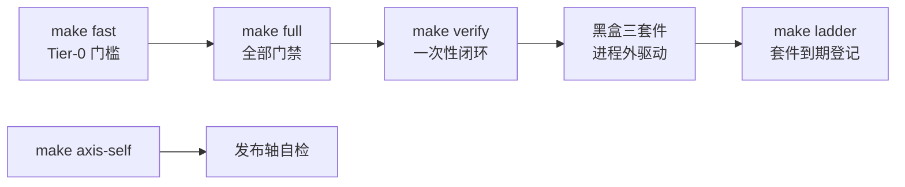

# AOCI-CODE - 架构分析

> 生成时间: 2026-10-13
> 分析对象: github.com/aoci-spec/aoci-code @ main (7586820)

## 1. 项目概览

### 1.1 项目信息

| 项目 | 内容 |
|------|------|
| 名称 | AOCI-CODE（AI-Oriented Cognition Infrastructure） |
| 语言 | Go 1.26.9（881 个 .go 文件；另有 Python 黑盒测试套件与 TS/Py 夹具） |
| 类型 | 本地 CLI + MCP 服务器（单二进制 `aoci`） |
| 版本 | v0.1.0-rc20 |
| 许可证 | FSL-1.1-MIT（满两年后转 MIT） |
| 描述 | 由 coding agent 编写、本地 MCP 服务器治理的持久化 Git 版本化代码库索引。Agent 一次读取索引即知全系统，免于每个任务重读仓库 |

**一句话定位**：AOCI 是"面向 AI 的认知基础设施"方法与协议——在编码智能体和软件系统之间加一层；AOCI-CODE 是其参考实现：`aoci` CLI + MCP 服务器 + 它们维护的纯文本索引（`aoci.txt` / `aoci.meta.txt` / `aoci.code.txt`，随项目入库、Git 版本化）。

### 1.2 目录结构

```text
aoci-code/
├── cmd/aoci/                 # 进程入口（main.go，零业务逻辑）
├── internal/                 # 42 个包，全部业务实现
│   ├── cli/                  # 命令树装配（cobra），约 250 文件
│   ├── mcptools/             # MCP 服务器与九工具实现
│   ├── index/                # 索引解析与治理核心
│   ├── fs/                   # 原子写/CAS/锁/Git 清单/安全路径（按 OS 分文件）
│   ├── baseline/             # 文件哈希基线（漂移检测）
│   ├── cognition*/           # 认知状态机（7 个子包）
│   ├── dbevidence/           # 数据库目录级证据采集（MySQL/PG/openGauss）
│   ├── dbcognition/          # 数据库认知（表级 FRAS 条目）
│   ├── llm/                  # OpenAI 兼容补全客户端（探针用，纯标准库）
│   ├── ui/                   # 回环状态面板（内嵌 page.html）
│   ├── hooks/                # 宿主集成安装（claude/codex/opencode…）
│   ├── safety/               # CI Action pin 等安全不变量
│   └── ...                   # config/workflow/prompt/volumegovernance 等
├── spec/public/              # 19 份公开运行时契约（权威事实源）
├── docs/                     # 21 份文档（双语，契约次级权威）
├── textassets/               # 本地化资产目录（en-US / zh-CN）
├── scripts/                  # 构建门禁脚本 + blackbox/（Python 黑盒套件）
├── third_party/              # openGauss Connector 本地补丁替换
├── aoci.txt / aoci.meta.txt / aoci.code.txt   # 本仓库自己的索引（653 行）
└── Makefile                  # fast/full/verify 三级验证门
```

值得注意：**项目吃自己的狗粮**——仓库根目录的 `aoci.code.txt` 就是用 AOCI 自身格式为全部 643 个文件写的一行一条的认知索引，是理解本仓库最快的一手资料。

## 2. 架构设计

### 2.1 架构模式

**六边形 / 端口-适配器变体 + 契约分层治理**。整体呈现四个清晰的环：

1. **入口层**（`cmd/aoci/main.go`）——只做进程启动，日志固定到 stderr，全部委托 `cli.Execute()`。
2. **接口层**（`internal/cli` + `internal/mcptools`）——同一套领域逻辑的两个渲染面：CLI（人读，cobra 命令树）与 MCP（机读，stdio JSON-RPC）。结构化错误 `Fail{Code,Msg,Hint}` 是唯一事实源，两个面各自渲染，禁止"解析文案反推结构"。
3. **领域层**（index/baseline/cognition*/volumegovernance/codebatch 等）——索引解析、基线 CAS、认知事务、卷治理、批次规划。
4. **平台层**（`internal/fs` 按 OS 分文件）——原子发布、锁、进程身份、Git 调用、安全清单。

在领域之上还有一条**契约权威链**（见 `docs/contract-authority.md`）：

```text
spec/public/*.txt（最高权威）
  → Live Guide / 工具 schema / Validator
    → docs/*.md
      → 仓库内索引与 AGENTS.md 集成块
```

关键架构纪律（散见于包注释与 AGENTS.md，均可在源码验证）：

- **无缓存原则**：每次 MCP 工具调用现读 index/baseline/config，用后即弃——"过期索引比没有更危险"是第一戒律（`internal/mcptools/server.go:11`）。
- **stdout 铁律**：MCP 子命令的 stdout 是 JSON-RPC 协议流，全仓任何日志不许碰 stdout（`cmd/aoci/main.go:5`、`internal/cli/root.go:17`）。
- **失败即停止**（fail closed）：门禁缺失就失败；发布工作流禁止 dry-run 发布。
- **两代共存**的命令注册：第一代各命令文件在 `init()` 中 `registerCommand` 自注册；第二代 ai/doctor/ui 由 `newRootCmd` 显式挂载（`internal/cli/root.go:4`）。

### 2.2 核心模块

| 模块 | 职责 | 关键文件 |
|------|------|----------|
| `internal/cli` | 命令树、参数解析、退出码映射、本地化、JSON 错误信封、恢复门（PersistentPreRunE 拦截未完成事务） | `root.go`、`init.go`、`scan.go`、`index_*.go`（约 40 个命令族） |
| `internal/mcptools` | MCP 服务器装配、九工具注册、panic guard、错误分类 | `server.go`、`tools_read.go`、`tools_write*.go`、`tools_maintain*.go` |
| `internal/index` | 索引文本解析、FRAS 条目结构、关系解析 | `parser.go` 等 |
| `internal/fs` | 原子写/CAS（Linux renameat2、Windows/macOS 各有实现）、目录锁（记录属主 PID，可处理属主消失）、Git 只读命令、Safe Inventory、安全路径校验 | `atomic.go`、`atomic_exchange_*.go`、`lock.go`、`git_command*.go`、`safe_inventory*.go` |
| `internal/baseline` | 源文件哈希基线；写入推进基线；变更产生漂移/Maintain 目标 | `baseline/` |
| `internal/cognition` + 6 个兄弟包 | 认知状态 v2、预算（budget）、优化（optimization）、规划（plan）、事务回执（txn）、基线（cognitionbaseline） | `cognitiontxn/transaction.go` 等 |
| `internal/dbevidence` | 数据库目录级只读证据采集；按服务器版本门控特性（MySQL CHECK 8.0.16 等）；拒绝 MariaDB | `collector.go`、`collector_mysql_version.go`、`collector_opengauss.go` |
| `internal/dbcognition` / `databasebootstrap` | 表级 FRAS 条目（database=table 对象）；证据绑定的授权式写入 | 对应目录 |
| `internal/llm` | OpenAI 兼容 /chat/completions 客户端，纯标准库，10MiB 响应上限——用于探针/认知测评，不参与索引内容生成 | `client.go` |
| `internal/ui` | 回环 HTTP 状态面板；`--detach` 后台化（Unix/Windows 各自实现）；仓库发现 | `server.go`、`detach_*.go`、`page.html` |
| `internal/hooks` | 宿主 MCP 集成安装（Claude Code、Codex、Cursor、OpenCode V1、Qoder） | `installer.go`、`claude.go`、`codex.go`、`opencode.go` |
| `internal/safety` | CI 工作流 Action pin 一致性等安全不变量检查 | `files.go` |
| `textassets` | en-US/zh-CN 双语消息目录（catalog + manifest 完整性测试），CLI/MCP/Guide/模板全部走它 | `catalog.go`、`manifest.json` |
| `internal/safetycmd` | 独立小工具入口（安全检查的二进制化） | `main.go` |

### 2.3 MCP 工具面（九工具，名称冻结为公共契约）

| 工具 | 类型 | 用途 |
|------|------|------|
| `aoci_rules` | 读 | 返回授权规则 / FRAS 纪律 / 字典（模型写条目前必读） |
| `aoci_overview` | 读 | 分块传输索引总览（带游标与结果大小声明） |
| `aoci_get_entries` | 读 | 按 path/前缀取条目 |
| `aoci_search` | 读 | 检索条目 |
| `aoci_update_entry` | 写 | 单条/批量回写（source SHA256 CAS 防陈旧写） |
| `aoci_report` | 读 | 状态/覆盖报告 |
| `aoci_remove_entry` | 写 | 删条目（带回执安全） |
| `aoci_header` | 读写 | 索引头查看/diff/应用 |
| `aoci_maintain` | 写 | 无参调用返回治理批次（Guide 驱动的维护闭环） |

工具名改动会破坏 AGENTS.md 模板与实验可复现性，属冻结契约（`internal/mcptools/server.go:8`）。

## 3. 数据模型：FRAS 索引格式

索引是"治理的纯文本"，三个卷（Volume）：

- **`aoci.txt`**（根清单）：声明卷布局 `meta → aoci.meta.txt`、`code → aoci.code.txt`（depends=meta）。
- **`aoci.meta.txt`**（元卷）：对象协议 `repository-cognition-object/v2`、FRAS 纪律 2、S 准入标准、S 配额（C9-8≤600 / C7-4≤200 / C3-1≤50）、标签字典。
- **`aoci.code.txt`**（代码卷）：每文件一行：

```text
atomic.go[CG9L]: F:职责 | R:需同读的文件 | A:外部依赖的公共契约 | S:不可推断且不可出错的约束
```

**标签四元组**：A 层（C-Code / D-Database）+ B 模块（G-General / S-Schema）+ C 重要性（9-core / 8-高频 / 7-业务 / 5-常规 / 3-支撑 / 1-边缘）+ E 规模（L>400 / M 200-400 / S 100-200 / T<100 行）。

**S 字段纪律**（`spec/public/s-field-discipline.txt`）：只收"不可从代码推断且防止出错"的事实——这是整个格式区别于符号图/仓库地图的核心。

## 4. 依赖分析

### 4.1 直接依赖（7 项，刻意最小化）

| 依赖 | 版本 | 角色 | 备注 |
|------|------|------|------|
| `github.com/spf13/cobra` | v1.10.2 | CLI 框架 | + pflag v1.0.10 |
| `github.com/modelcontextprotocol/go-sdk` | v1.6.1 | MCP 服务器 SDK | 官方 Go SDK |
| `github.com/jackc/pgx/v5` | v5.11.0 | PostgreSQL 驱动 | 目录元数据 |
| `github.com/go-sql-driver/mysql` | v1.10.1 | MySQL 驱动 | 5.7.6+，拒绝 MariaDB |
| `gitcode.com/opengauss/openGauss-connector-go-pq` | v1.0.8 | openGauss 驱动 | **本地 replace → `third_party/`**，补丁可重放、字节可比对（`scripts/check-opengauss-connector.sh` 门禁） |
| `golang.org/x/sys` | v0.48.0 | 平台系统调用 | 锁属主探测、原子交换等 |

`go.mod` 的 `replace` 指令配合 `.PROVENANCE.md`、`THIRD-PARTY-NOTICES`（22 模块发布矩阵）与 `make licenses` 构成供应链审计闭环。`go` 指令带完整补丁版本号（1.26.9），因为 CI 用 `go-version-file` 装工具链且 `GOTOOLCHAIN=local` 许可门禁拒绝切换。

### 4.2 间接依赖

12 项间接依赖全部来自上述驱动/SDK 的传递闭包（edwards25519、puddle、jsonschema-go、gmsl 等），无 Web 框架、无 CLI 之外的重量级库。`internal/llm` 甚至不引入 SDK——纯标准库 `net/http`。

### 4.3 构建期/测试期依赖（不在 go.mod）

- **Python 3**：黑盒三套件 `mcp_conformance.py` / `mcp_scenarios.py` / `mcp_lifecycle.py`（从进程外驱动构建出的二进制），另有 `realrepo.py`（对真实仓库的升级轴测试）、`ladder.py`（套件到期登记）。
- **GoReleaser v2**：六平台 CGO-Free 归档（linux/darwin/windows × amd64/arm64），Windows 用 zip。
- **staticcheck / go fuzz / cosign（keyless）/ gh attestation**：静态分析、模糊测试、发布签名与物料证明。

## 5. 测试与质量体系



- **`make fast`**：fmt-check + 快测 + 构建——永不充分（Tier-0）。
- **`make full`**：`clean-room-smoke`、`licenses`、`race`（30 分钟超时防挂起）、`vuln`、`database-integration`、覆盖地板（`scripts/coverage-floors.txt`）、模糊冒烟、静态分析。
- **`make verify`**：构建一次，`-k` 聚合报告全部失败，再跑黑盒三套件——本地闭环单命令。
- 单元测试密度极高（`internal/cli` 约 250 文件中近半是 `_test.go`；golden 再生需 `AOCI_UPDATE_GOLDEN=1` 显式开启）。
- CI（`.github/workflows/ci.yml`）：Action 全部 SHA-pin 且跨工作流一致（由 `internal/safety` 校验）；每 job 有超时。

## 6. 架构亮点与权衡

**亮点**

1. **单一事实源的错误模型**（`Fail{Code,Msg,Hint}`）+ 稳定退出码契约（0/1/2/3/10），CLI 与 MCP 双面渲染不漂移。
2. **CAS 防陈旧写贯穿始终**：源文件 SHA256 基线 + 索引写后像确认 + 目录锁属主探测，把"agent 写旧快照"这一类事故变成可检测的冲突。
3. **事务回执恢复门**：任何未完成的认知事务（bootstrap/migration/scope/entries…）会在 `PersistentPreRunE` 拦截除只读与恢复命令之外的一切（`internal/cli/root.go:197`），崩溃后不可能带着半状态继续写。
4. **本地化即契约**：所有运行时文本进 `textassets` 目录，带清单完整性、locale 奇偶性、与"Git stderr 原样透传是唯一例外"（`docs/localization.md`）的测试。
5. **自我索引**：仓库用自己的格式描述自己，架构文档与代码同源演化。

**权衡/代价**

1. **`internal/` 巨包群**：42 个包、命令实现文件按"命令族 × 关注点"切成数百个小文件，新人定位需要靠索引本身（这恰是项目论点的自证）。
2. **两代命令注册共存**：`init()` 自注册 + 显式挂载并存，属于演化的中间态（源码注释亦如此声明）。
3. **契约密度带来变更成本**：改一个工具名/默认值会同时碰 AGENTS.md、spec、textassets、黑盒 golden——由门禁强制而非可选。
4. **FSL-1.1-MIT 许可**：源码可见但非 OSI 开源，两年后才自动转 MIT，商用接入需先读 LICENSE 的 Permitted Purpose 条款。

## 7. 结论

AOCI-CODE 是一个**治理优先、契约驱动**的 Go 单二进制项目：CLI 与 MCP 双入口共享领域层，平台差异隔离在 `internal/fs` 的按 OS 文件中，依赖刻意压到 7 个直接项，质量体系以"fast/full/verify 三级门 + 进程外黑盒套件"纵深覆盖。它把"AI 如何持久地理解一个代码库"这个问题编码成了带 CAS、预算、配额与恢复事务的文本协议——而仓库里那份 653 行的自索引，既是产品演示也是最好的架构文档。
