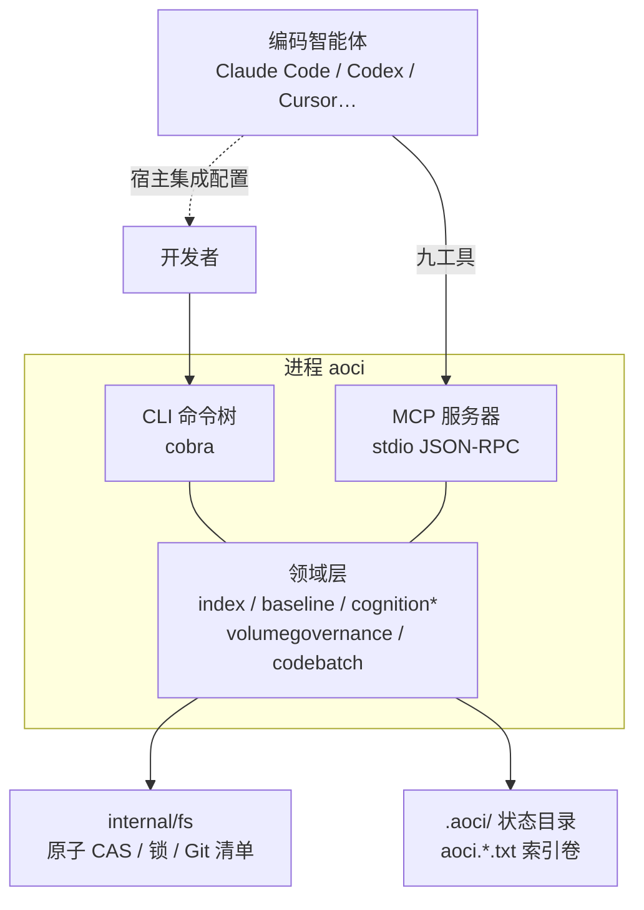
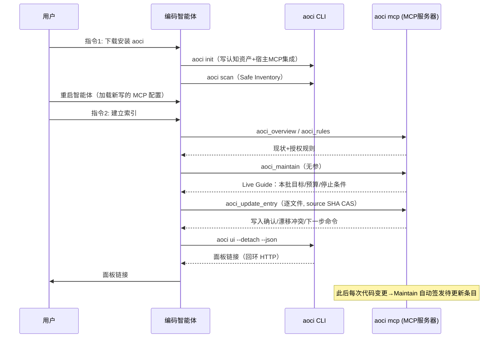
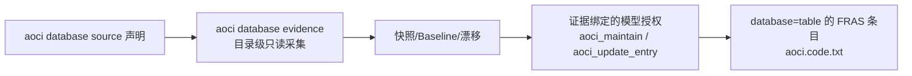

# AOCI-CODE - 运行机制分析

> 生成时间: 2026-10-13
> 分析对象: github.com/aoci-spec/aoci-code @ main (7586820)

## 1. 进程与入口

### 1.1 入口点（5 个 main）

| 入口 | 角色 |
|------|------|
| `cmd/aoci/main.go` | 产品二进制 `aoci` 的唯一进程入口 |
| `internal/safetycmd/main.go` | 安全检查独立工具（CI 不变量校验的二进制化） |
| `scripts/blackbox/longrun-refresh/main.go` | 长跑刷新黑盒夹具 |
| `scripts/release/archive-smoke/main.go` | 发布归档冒烟 |
| `scripts/release/manifest/main.go` | 发布清单/签名校验（`signed_release.go`、`signed_bundle.go`） |

### 1.2 启动链路

```text
main()                                  cmd/aoci/main.go
 ├─ log.SetOutput(os.Stderr)            # 铁律: stdout 留给 JSON-RPC
 └─ cli.Execute()
     └─ executeCLIWithInput()
         ├─ resetRootFlags()            # 进程语义 vs 库复用语义一致化
         ├─ activateInvocationLocale()  # Cobra 建树前先定 locale（--locale > config > 默认）
         ├─ textassets.ValidateRuntime()# 消息目录完整性校验，失败即内部错误
         ├─ isMCPInvocation(args)?      # 顶层命令 token == "mcp"
         │   ├─ 是 → 直通路径: stdout 不缓冲, JSON-RPC 帧时序不被破坏
         │   └─ 否 → 缓冲路径: 先写内存 buffer, 失败时裁决"是否已输出业务 JSON"
         │            （避免双 JSON 对象; Windows 下最终写出转 ASCII 安全 JSON）
         └─ root.Execute() → PersistentPreRunE: enforceCognitionRecoveryGate
```

**恢复门（Recovery Gate）** 是启动链路里最关键的运行时不变量（`internal/cli/root.go:197`）：任何命令执行前先查 `cognitiontxn.Pending(root)`——存在未完成的事务回执（bootstrap / migration / reversal / scope / remove / entries / header）时，只放行三类命令：

1. 只读面：`aoci index agent guide`、`aoci mcp`、`verify`、`check`、`status`、`scope status`；
2. 该回执自己的 status / resume / rollback 控制；
3. 多张回执并存时取最窄门。

这保证**崩溃后不可能带着半完成状态继续写索引**——进程死了，回执还在 `.aoci/` 状态目录里，下次任何写命令都会被拦到恢复流程。

### 1.3 退出码契约

| 码 | 含义 | 典型来源 |
|----|------|----------|
| 0 | 成功 | — |
| 1 | 漂移或检查失败 | verify/check 发现索引与代码不一致 |
| 2 | 输入/索引/治理状态无效 | 未完成事务回执、索引不可解析 |
| 3 | 未初始化/配置/参数错误 | 无 `aoci.txt`、参数缺失 |
| 10 | 内部错误 | 不变量破坏 |

`ExitError` 携带可选 `MachineCode`（如 `write_conflict`、`cognition_recovery_pending`），不改进程退出码，只把领域级失败类别透传给 JSON 消费者。

## 2. 两条执行面：CLI 与 MCP



### 2.1 CLI 面（约 40 个命令族）

顶层命令（从源码 `Use:` 字符串与 `root.go` 汇总）：`init`、`scan`、`mcp`、`verify`、`check`、`status`、`doctor`、`ai`、`ui`、`hook`、`config`、`remove-entry`、`update-entry`、`index`（子树：agent guide/plan/stage/header/entries/update/build/score/diff…）、`cognition`（bootstrap/migration/onboard/plan/system…）、`baseline`、`scope`（approve/activate/authorize/budget/rule/safety…）、`database`（source/evidence/baseline/snapshot/cognition…）。

输出纪律（`internal/cli/root.go` 注释块）：

- 普通命令在 `--json` 下失败且尚未输出业务 JSON 时，由根层输出**唯一**错误信封；
- Verify/Check 已输出完整业务 JSON 再返回非零码时不追加第二个 JSON；
- Windows 普通 CLI 的合法 `--json` 结果最终写出时转 ASCII 安全 JSON（防 PowerShell 5 本地代码页破坏 UTF-8 中文，`internal/cli/json_ascii.go`）。

### 2.2 MCP 面（`aoci mcp`）

```text
aoci mcp → config.FindRepoRoot → signal.NotifyContext(SIGINT/SIGTERM)
        → mcptools.RunStdio(ctx, root, version)
```

运行时纪律（`internal/mcptools/server.go` 包注释）：

1. **stdout 只出 JSON-RPC**；启动不打印横幅、不自动 scan（防慢启动）；一切日志走 stderr。
2. **九工具名冻结**：`aoci_rules` / `aoci_overview` / `aoci_get_entries` / `aoci_search` / `aoci_update_entry` / `aoci_report` / `aoci_remove_entry` / `aoci_header` / `aoci_maintain`。
3. **无缓存**：每次工具调用现读 index/baseline/config，构造 `repoCtx` 用后即弃——索引可能被 MCP 外通道（编辑器手改、`git pull`）修改。
4. **panic guard**：handler 内 panic 被 `guard()` 恢复为 MCP error 结果 + stderr 记录，进程不崩、连接不断。
5. 参数全 string/[]string，返回纯文本；错误响应带分类码与下一步建议，不含 Go stack trace。

## 3. 核心生命周期：从 init 到自动维护



### 3.1 `aoci init`（`internal/cli/init.go`）

- 按仓库指纹（`fingerprintInitPath`）与 agent 候选路径（`initAgentCandidatePaths`）写入认知资产：`aoci.txt`、`aoci.meta.txt`、`aoci.code.txt`、AGENTS.md 集成块；
- 安装宿主 MCP 集成（Claude Code / Codex / Cursor / OpenCode V1 / Qoder；不写项目配置的宿主则输出需手贴的配置）；
- 写宿主自身的 ignore 配置（区别于认知资产——**认知资产绝不能进 .gitignore**，否则 scan 会静默跳过）；
- 推进 init 基线（`advanceInitBaseline`）；支持 `--locale`（en-US / zh-CN）。

### 3.2 `aoci scan`（`internal/cli/scan.go`）

- 文件清单**取自 Git**（Safe Inventory，`internal/fs/safe_inventory*.go`）——所以非 Git 根只读不到 .gitignore 规则、被忽略的认知资产会被静默跳过（scan 里有 `refuseGitHiddenFormalAssets` 专门拒绝这种状态）；
- 评估 Managed Scope 角色（managed / candidate / excluded；硬排除目录整体坍缩成一行）；
- 统计 submodule；产出 scope 提案与审批工件（`internal/scoperefresh` / `internal/scopechange`）。

### 3.3 索引构建（Guide 驱动的批次闭环）

Volumes v1 布局的正规路径（`docs/getting-started.md`、`docs/cognition-volumes.md`）：

1. **Guide**：`aoci index agent guide`（或 MCP 无参 Maintain 触发）返回 Live Guide——机器事实 + 本批目标 + 预算 + 停止条件 + next_commands；
2. **批次**：模型按 Guide 给的文件清单逐个调用 `aoci_update_entry` 写 FRAS 条目；每条写入要求 source SHA256 CAS——源文件在读取后变了就拒绝写入（`write_conflict`）；
3. **预算治理**：`internal/cognitionbudget` 限制批次规模与 S 配额（C9-8≤600 / C7-4≤200 / C3-1≤50）；超预算触发重规划而非截断；
4. **验证**：`aoci verify` / `aoci check` / Guide 终态证明。

约 20 万行代码首建索引耗时约 1 小时（按模型与智能体速度），分批进行、中断可续。

### 3.4 维护闭环（首次索引之后）


基线（`internal/baseline`）记录每个受管文件的哈希；写入条目同时推进对应目标与索引的基线；下次 Maintain 发现漂移即签发该文件的更新任务——"维护是自动的，但你从不需要专门停下来维护"。

## 4. 写路径的原子性与并发控制

`internal/fs` 是所有持久化的地基：

| 机制 | 实现 | 平台 |
|------|------|------|
| 原子创建 | `atomic_create_{linux,darwin,windows,other}.go` | Linux O_CREAT|O_EXCL；Windows/其他各自实现 |
| 原子交换 | `atomic_exchange_{linux,darwin,windows,other}.go` | Linux renameat2/RENAME_EXCHANGE；失败降级有测试护栏 |
| 原子写/CAS | `atomic.go`：AtomicWrite / AtomicWriteCAS / AtomicCreateCAS / AtomicMoveCAS | "原生发布绝不降级为覆盖式 rename"是 S 级铁律 |
| 目录锁 | `lock.go` + `lock_owner_open_{windows,other}.go` | 锁文件记录属主 PID；属主进程消失（含 9p/Windows 共享场景）时可安全接管（`lock_vanished_owner_test.go`） |
| 进程身份 | `process_identity_{linux,unix,windows,other}.go` | 跨平台确认"锁属主是否还活着" |
| Git 调用 | `git_command{,_windows,_other}.go` | 只读命令；Git 失败 stderr 原样透传（唯一不翻译的运行时文本） |

写入协议（`tools_write*.go` 消息目录可见全序列）：lock_timeout → cas_read → cas_stale（源或索引已变 → replan）→ index_write → postimage_unconfirmed（写后像确认）→ baseline_save → baseline_advanced。任何一步失败都有对应的机器码与 Hint，多数冲突要求**用同一 candidate_id 重试或重新规划**，而不是盲目覆盖。

## 5. 认知事务与恢复

`internal/cognitiontxn` 把每次多步写操作记录为 `.aoci/` 下的回执文件（operation ∈ bootstrap / migration / reversal / scope / remove / entries / header）：

- 操作开始写回执，完成删除；中断后回执残留；
- 下次任何 CLI 调用被 `enforceCognitionRecoveryGate` 拦截（见 §1.2）；
- 各操作有专属 `status / resume / rollback` 三件套（如 `aoci cognition bootstrap status|resume|rollback`、`aoci index entries recover`）；
- MCP 写回执通过 MCP 工具闭环（Guide 会点名），CLI 侧只留只读面与控制面开放。

## 6. 数据库认知（第二索引）



- 只采**目录元数据**（表结构），永不读业务数据；凭据只引用环境变量名、从不落盘；
- 驱动矩阵：PostgreSQL（pgx）、MySQL 5.7.6+（拒绝 MariaDB；CHECK 约束按 8.0.16 门控、索引表达式 8.0.13、可见性 8.0.0）、openGauss 6.0.5（本地补丁连接器，verify-full TLS，仅 A/PG 基表）；
- 证据失败绝不推进 Evidence 状态；授权只使用已接受的保存证据、Maintain/Apply 期间**从不重连**数据库。

## 7. 状态面板（`aoci ui`）

- 回环 HTTP 服务 + 内嵌 `page.html`（`internal/ui/embed.go`），注册信息写在用户缓存目录；
- `aoci ui --detach --json` 后台化（`detach_unix.go` / `detach_windows.go` 分平台）并输出 JSON（智能体可解析的链接）；
- 仓库发现（`discover.go`，Linux 有专属实现）+ 缓存（`cache.go`）。

## 8. LLM 客户端（`internal/llm`）

OpenAI 兼容 `/chat/completions`，纯标准库 `net/http`：10MiB 响应上限防 OOM、如实转达 usage（缺失则标记 missing 交上层决定）。它服务于**探针/认知测评**（`ai_probe_contract.go`、cognition 状态里的掌握度百分比），不是索引内容的生成通道——索引文本由用户自己的智能体经宿主的模型通道写出，AOCI 不新增数据出口。

## 9. 安全边界（运行时）

- **本地优先**：唯一对外连接是声明的数据库（目录元数据）与自身回环面板；永不上网、不上传；
- **凭据零落盘**：环境变量名引用；
- **路径安全**：`safe_path.go` 校验拒绝仓库外路径（`path_unsafe` 错误码）；
- **信号**：SIGINT/SIGTERM 优雅退出（context 取消，`internal/cli/mcp.go`）；
- **发布件**：keyless 签名 + attestation + SBOM + SHA256SUMS 重建（发布工作流四门禁）。

## 10. 小结

AOCI-CODE 的运行机制围绕一个中心设计：**索引文本是共享可变状态，而智能体是异步、可崩溃、会写旧快照的写者**。因此全部运行时设施——CAS 基线、目录锁与属主探测、事务回执恢复门、无缓存的 repoCtx、Guide 驱动的批次预算、postimage 确认——都在把"并发写文本文件"这件本质不可靠的事变成带机器码错误、可恢复、可验证的协议。CLI 与 MCP 是同一协议的两个人机界面，而退出码契约与 `Fail{Code,Msg,Hint}` 保证两个界面对同一失败给出同一分类。
